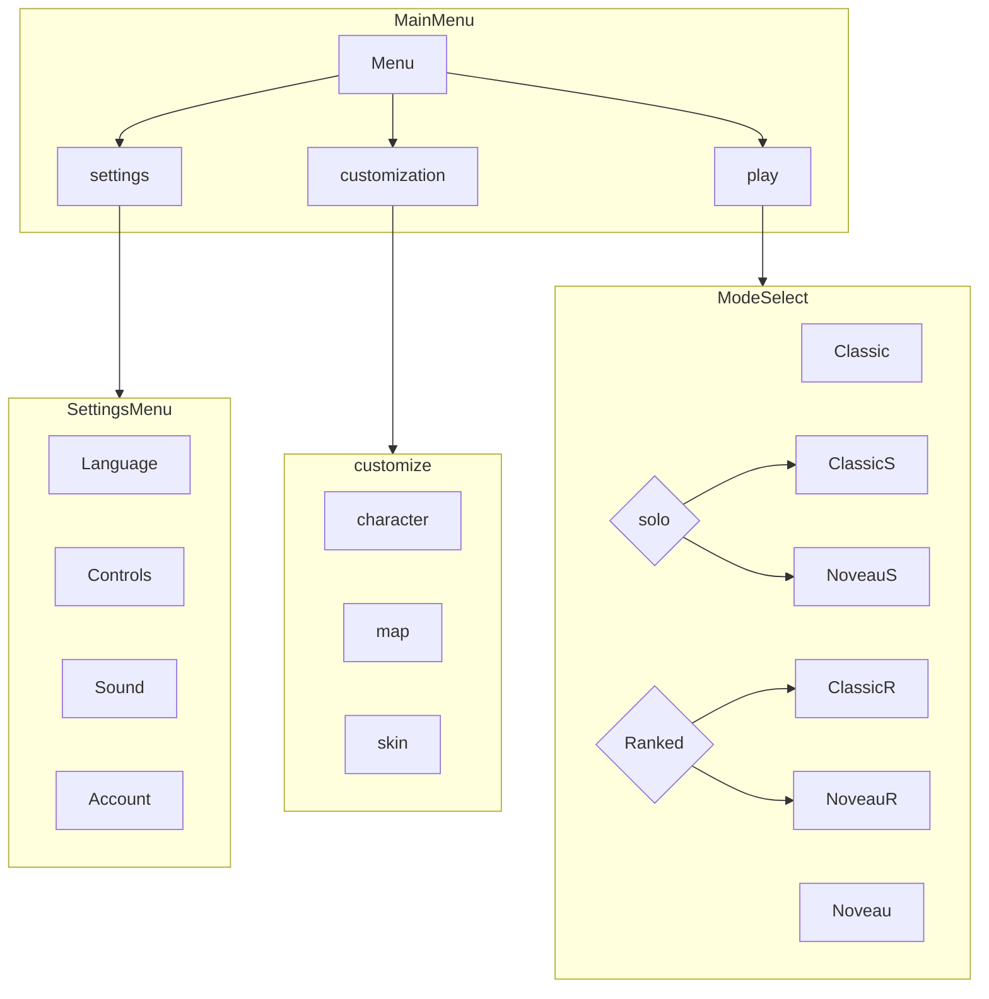

Le pouvoir necessite des sacrifices. dans cette monde, mangez, ou faites vous mangez, ce sont vos seuls choix. laquelle vous choisirez?

## Platform

Navigateur web

# Core gameplay

## Boucle principale

Jouer -> gagner de l'argent -> perdre -> acheter des cosmetics/personnages -> jouer

## Controls

Clavier ou souris

## Conditions de gagne/perte

Gagne: jeu de survie, on joue jusqu'a ce qu'on perd
Perte: avoir sa taille reduite jusquá 0 par un de moyens suivants:
- se faire mangé par un autre joueur
- un des pieges presents sur le map

## Modes de jeu

- Classique: Agar.io sans modifications. ici les personnages n'ont pas leur pouvoirs et il y a un nombre minimum des pieges
- Noveau: les personnages auront des pouvoirs selon le personnage utilisé, les attaques, pieges, techniques de defenses, tout joue dans cette aréne chaotique
- Solo: Jouez contre les bots qui prennent la place des joueurs. les pouvoir sont autorisées ici donc c'est le moment parfait pour s'entrainer. peut se faire en Noveau et Classique
- Ranked: mêmes regles de Nouveau, sauf qu'il y a un ranking mondial qui joue. serez vous les grands masters de Pagario?

# Systems (regles)

Vue orthographique d'haut, le terrain de jeu est en 2D ou on se deplace dans les 4 directions.
## Movement

deux choix de controle: 
- Clavier: 
	- WASD (ZQSD) ou fléches: se déplacer
	- ESPACE: se diviser
	- C: se disperser en petits boules qui peuvent être mangé soit par nous soit par des autres joueurs
	- V: pouvoir speciale selon le personnage
- Souris
	- DIRECTION DE SOURIS: se deplacer dans le direction de souris
	- CLICK GAUCHE: pouvoir speciale selon le personnage
	- CLICK DROITE: se diviser
	- CLICK CENTRE: se disperser

## Combat

Mode classique: les joueurs rentre en "combat" lors de contact, le joueur le plus grand mange le joueur le plus petit, par contre les grands joueurs sont plus lent que les petits joueurs

Modes Ranked, Solo, Nouveau: mémes regles de mode classique, sauf l'ajout de pouvoir des personnages. tous les combats vont dependre des personnages participants.

## Economy

l'argent gagné depend de nombre de joueurs tué/mangé

## Player journey (flow)

